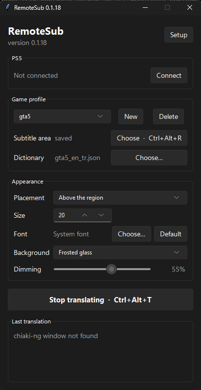

<div align="center">

# RemoteSub

**Live subtitle translation for PS5 games, running entirely on your own computer.**

Play a PS5 game through Remote Play on your PC or Mac, and RemoteSub reads its English subtitles
and shows them in Turkish, right on top of the game, as they appear.

**English** · [Türkçe](README.tr.md)

[](https://github.com/torunf/remoteSub/releases/latest)


</div>

---

## Why?

Many PS5 games ship without Turkish. RemoteSub was built to play a game you own in a language you are
comfortable with, without modifying the game or the console. It doesn't touch the PS5 at all: it only
reads what is already on your screen.

## How it works

```
 PS5 ──home network──▶ chiaki-ng (Remote Play on your computer)
                              │  picture
                              ▼
                         RemoteSub
                          1. reads the subtitle area (OCR)
                          2. translates the line (dictionary first, then a local AI model)
                          3. draws the translation over the game
```

- **OCR** (reading text from the picture): Windows' built-in OneOCR, or the open-source RapidOCR when
  that isn't available; Apple Vision on macOS.
- **Translation**: Google's [TranslateGemma](https://ollama.com/library/translategemma) model, run
  locally through [Ollama](https://ollama.com). Nothing is sent to an online service.
- **Dictionaries** (optional): a file of ready-made translations for a game. A line found in it appears
  in a few milliseconds, without waiting for the model.
- **Remote Play**: the open-source [chiaki-ng](https://github.com/streetpea/chiaki-ng). RemoteSub
  installs and configures it for you.

<p align="center">
  
</p>

## Features

- One installer per platform; the setup window installs and configures everything else.
- Connects to your PS5 automatically when it starts.
- Per-game profiles: subtitle area, dictionary, font, size and look are remembered for each game.
- The subtitle area is stored relative to the game picture, so moving or resizing the chiaki-ng
  window doesn't break it.
- Three placements: covering the subtitle area, above it, or exactly in place of the English text.
- Two backgrounds: frosted glass (a blurred copy of the game) or see-through with adjustable dimming.
- Use any font file, for example the game's own typeface.
- Dictionaries that reload by themselves while you play.
- Global hotkeys, automatic updates (macOS), English or Turkish interface depending on your system.

## Requirements

| | Windows | macOS |
|---|---|---|
| System | Windows 10 or 11, 64-bit | macOS 13 or later, **Apple Silicon** (M1 or newer) |
| Memory for the AI model | A graphics card with **10 GB+** for the better model; less works with the smaller one | **24 GB+** unified memory for the better model; less works with the smaller one |
| Disk | About 10 GB (apps + model) | About 10 GB |

You also need a **PS5** with Remote Play turned on, on the **same home network** as the computer (a wired
connection gives the best picture), and a PSN account. An internet connection is needed only for the
first setup and for updates.

> Intel Macs are not supported: chiaki-ng only publishes Apple Silicon builds for macOS.

## Installation

### Windows

1. Download `RemoteSub-Setup-<version>.exe` from the [latest release](https://github.com/torunf/remoteSub/releases/latest).
2. Run it and approve the administrator prompt. It installs RemoteSub and, if missing, chiaki-ng.
   - Windows may show *"Windows protected your PC"* because the installer isn't code-signed yet:
     click **More info → Run anyway**.
3. When it finishes, RemoteSub opens its setup window. Continue with [First run](#first-run).

### macOS

1. Download `RemoteSub-<version>.pkg` from the [latest release](https://github.com/torunf/remoteSub/releases/latest).
2. Open it and follow the installer. It puts **RemoteSub** and **chiaki-ng** into Applications.
   The package is signed and notarized by Apple, so it opens without warnings.
3. RemoteSub opens its setup window when the installation ends.

## First run

The setup window lists every requirement with a ✓ or ✗. Press **Install all** and it works through
them in order:

| Step | What happens |
|---|---|
| **chiaki-ng** | Installed if it isn't there yet. |
| **PS5 pairing** | Needs you once. On the PS5: *Settings → System → Remote Play → Enable Remote Play*. In the chiaki-ng window that opens, click your PS5 and sign in with PSN. Then on the PS5: *Remote Play → Pair Device*, and type the 8-digit code into chiaki-ng. The setup window notices when pairing is done. |
| **chiaki-ng settings** | RemoteSub sets chiaki-ng to connect to your PS5 automatically (and, on Windows, to use the d3d11va video decoder, which avoids a corrupted picture on some PCs). |
| **Ollama** | Installed and started. |
| **Translation model** | Downloaded (3–8 GB). The larger `translategemma:12b` is chosen when your computer has enough memory, otherwise `translategemma:4b`. |
| **OCR** | Nothing to install. |
| **Permissions** (macOS) | Screen Recording is required; Accessibility is needed only for the hotkeys. Turn RemoteSub on in *System Settings → Privacy & Security*, then quit and reopen RemoteSub. |

When everything is green, press **Start**.

## Everyday use

1. Open RemoteSub. It starts chiaki-ng and connects to the PS5 on its own.
2. Choose a profile for the game, or press **New** and give it the game's name.
3. When a subtitle is on screen, press **Choose** next to *Subtitle area* (or `Ctrl+Alt+R`) and drag
   a box around where the subtitles appear. Do this once per game.
4. Translation starts. The *Last translation* box shows the English line, its translation and how long
   it took.

### Hotkeys

| Windows | macOS | |
|---|---|---|
| `Ctrl+Alt+T` | `Ctrl+⌥+T` | Start / stop translating |
| `Ctrl+Alt+R` | `Ctrl+⌥+R` | Choose the subtitle area |
| `Ctrl+Alt+H` | `Ctrl+⌥+H` | Hide / show the translation |
| `Ctrl+Alt+S` | `Ctrl+⌥+S` | Save a screenshot including the translation |

### Appearance

- **Placement**: *Cover the region* hides the original subtitles completely; *Above the region* keeps
  them visible; *In place of the English text* puts the translation exactly where the English line is,
  widening the box when the translation is longer.
- **Background**: *Frosted glass* blurs the game behind the text; *See-through, dimmed* keeps the game
  visible and darkens it by the **Dimming** percentage. Higher dimming hides the original text better.
- **Font** and **Size**: any `.ttf` / `.otf` file can be used. RemoteSub warns you if the font lacks
  Turkish letters.

## Android TV

RemoteSub also runs on Android TV / Google TV as its own app, **RemoteSub TV**. It is a PS5 Remote Play
client (built on chiaki-ng's Android code) with RemoteSub built in: it reads the subtitles straight from the
decoded video, so no screen recording permission or overlay permission is needed.

| | |
|---|---|
| **OCR** | Google ML Kit, on the TV |
| **Translation** | 1. the profile's dictionary → 2. TranslateGemma through Ollama on a computer on the home network → 3. ML Kit's offline model on the TV when that computer can't be reached (lower quality) |
| **Controls** | Gamepad buttons go to the PS5. On the TV remote, **OK** (or Menu) opens the RemoteSub menu; **Captions** turns translation on/off |

**Setup**

1. Install `RemoteSub-TV-<version>.apk` on the TV (for example with `adb install`, or a sideloading app).
2. Open it, add your PS5 and pair it as in chiaki-ng (Remote Play → Pair Device, 8-digit code).
3. *Settings → RemoteSub*: try **Try it without a PS5** first. To use the better model, enter the computer
   running Ollama under **Ollama server** (for example `192.168.1.20`) and press **Test the connection**.
   Ollama must listen on the network: on macOS run `launchctl setenv OLLAMA_HOST 0.0.0.0` and restart
   Ollama; on Windows set the `OLLAMA_HOST` environment variable to `0.0.0.0`.
4. While playing, press **OK** → *Choose the subtitle area*. Arrows move the box, OK switches to resizing,
   Back saves. Do this once per game profile.

Dictionaries are the same JSON files as on the desktop, given by address, e.g. serve your dictionary
folder with `python3 -m http.server 8000` and enter `http://192.168.1.20:8000/game_en_tr.json`. The TV
keeps a copy, so it still works when the computer is off.

Build it with `scripts/build_android.sh 0.1.0` → `dist/RemoteSub-TV-0.1.0.apk`. The Android TV app's code is
under `android/`, and because it includes chiaki-ng it is licensed under the **AGPL-3.0** (`android/LICENSE`).

## Dictionaries

A dictionary is a JSON file that maps original lines to translations:

```json
{
  "Back then, sure. Not now.": "O zaman olsa, tabii. Şimdi olmaz.",
  "Does he know how long you've been working with the FIB?": "FIB ile ne kadar zamandır çalıştığını biliyor mu?"
}
```

Attach one to a profile with **Choose…** next to *Dictionary*. Every subtitle is looked up there first,
tolerating small OCR mistakes. Only lines that aren't found go to the AI model. The *Last translation*
box tells you which one answered (*dictionary*, *cache* or *model*). If the file changes while you play
(for example while more lines are being translated), RemoteSub picks up the new version within 30 seconds.

A dictionary built from a game's own text is usually by far the best option: it is instant, and if it
comes from a human translation it reads much better. **Game text belongs to its publisher, so keep
dictionaries for your own use and don't publish them.**

## Privacy

Subtitles are read and translated on your computer. RemoteSub only goes online to download its
components (chiaki-ng, Ollama, the model) and to check GitHub for updates. Settings, profiles, logs and
screenshots are stored in `%APPDATA%\RemoteSub` (Windows) or `~/Library/Application Support/RemoteSub` (macOS).

## Updates

On macOS, RemoteSub checks for a new version when it starts and every few hours. When there is one, an
**Update** button appears; RemoteSub checks that the package is signed by its developer and notarized
by Apple, installs it (macOS asks for your password) and restarts. On Windows, download the new
installer from the releases page for now.

## Troubleshooting

<details>
<summary><b>chiaki-ng says "Remote is already in use"</b></summary>

The PS5 streams to one device at a time. Close Remote Play on the other device (another computer, a
phone or the official PS Remote Play app) and try again.
</details>

<details>
<summary><b>Translations are made but nothing appears on screen</b></summary>

Update to the latest version. On Windows, the subtitle area must be visible on screen: if the bottom of
the chiaki-ng window is hidden behind the taskbar or off the screen, maximize chiaki-ng or make it full
screen.
</details>

<details>
<summary><b>macOS keeps asking for Screen Recording permission</b></summary>

An old permission entry from an earlier build may be in the way. Quit RemoteSub, run
`tccutil reset ScreenCapture com.torunf.remotesub` in Terminal, open RemoteSub and allow it again, then
quit and reopen it.
</details>

<details>
<summary><b>The stream picture is blue, dark or flickering (Windows)</b></summary>

Open *Setup* and make sure *chiaki-ng settings* is green; it switches chiaki-ng to the d3d11va decoder.
</details>

<details>
<summary><b>Translations are slow</b></summary>

The first translation after starting is slow while the model loads. After that, expect about half a
second per line on a recent graphics card, and more on smaller machines. A dictionary for the game
makes most lines instant.
</details>

<details>
<summary><b>The interface is in the wrong language</b></summary>

RemoteSub follows the system's display language. To force one, set `"language": "en"` or `"tr"` in
`config.json` in the settings folder (see [Privacy](#privacy)).
</details>

## Building from source

```bash
pip install -r requirements.txt
python src/remotesub.py --no-connect   # run without connecting to the PS5
python src/remotesub.py --setup        # always show the setup window
```

| Command | Result |
|---|---|
| `scripts\build_windows.ps1 -Version 1.2.3` | `dist\RemoteSub-Setup-1.2.3.exe` (needs Inno Setup 6) |
| `scripts/build_mac.sh 1.2.3` | `dist/RemoteSub-1.2.3.pkg` (on an Apple Silicon Mac) |

Every push to `main` builds both installers on GitHub Actions and publishes them as a release. The
macOS package is signed and notarized when the signing secrets are configured.

| Path | |
|---|---|
| `src/remotesub.py` | Control window, capture → OCR → translation loop, overlay drawing |
| `src/setup_steps.py` | Setup steps and the setup window |
| `src/platform_win.py`, `src/platform_mac.py` | Windows / macOS specifics: windows, capture, overlay, hotkeys, installing and configuring chiaki-ng and Ollama |
| `src/ocr_engine.py` | OneOCR, RapidOCR and Apple Vision |
| `src/dictionary.py` | Dictionary lookups |
| `src/i18n.py` | Interface translations |
| `installer/` | Windows (Inno Setup) and macOS (pkg) installer files |

## Credits

RemoteSub stands on these projects:

- [chiaki-ng](https://github.com/streetpea/chiaki-ng) (AGPL-3.0): PS5 Remote Play. It is shipped
  unmodified as a separate program inside the installers; its source code is in its repository.
- [Ollama](https://ollama.com) and Google's [TranslateGemma](https://ollama.com/library/translategemma) for translation.
- [RapidOCR](https://github.com/RapidAI/RapidOCR) (Apache-2.0); Microsoft's OneOCR is used from the
  Windows Snipping Tool and is not redistributed; Apple Vision on macOS.
- [Sun Valley ttk theme](https://github.com/rdbende/Sun-Valley-ttk-theme) (MIT), [RapidFuzz](https://github.com/rapidfuzz/RapidFuzz) (MIT), [Pillow](https://python-pillow.org), [PyObjC](https://github.com/ronaldoussoren/pyobjc).

RemoteSub isn't affiliated with Sony Interactive Entertainment or any game publisher. PlayStation and
PS5 are trademarks of Sony Interactive Entertainment Inc.
