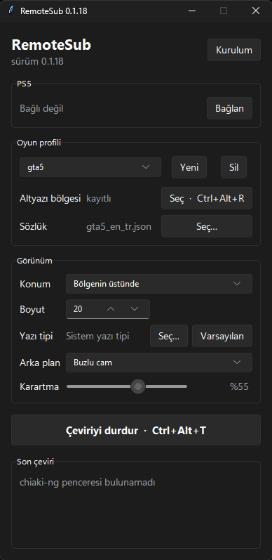

<div align="center">

# RemoteSub

**PS5 oyunları için canlı altyazı çevirisi, tamamen kendi bilgisayarında.**

PS5 oyununu Remote Play ile bilgisayarında ya da Mac'inde oynarken RemoteSub oyunun İngilizce
altyazılarını okur ve ekrana geldikleri anda Türkçesini oyunun üstünde gösterir.

[English](README.md) · **Türkçe**

[](https://github.com/torunf/remoteSub/releases/latest)


</div>

---

## Neden?

Birçok PS5 oyununda Türkçe dil seçeneği yok. RemoteSub, sahip olduğun bir oyunu rahat ettiğin dilde
oynayabilmek için yapıldı. Ne oyunu ne konsolu değiştirir; PS5'e hiç dokunmaz, sadece ekranında zaten
görünen şeyi okur.

## Nasıl çalışır?

```
 PS5 ──ev ağı──▶ chiaki-ng (bilgisayardaki Remote Play)
                       │  görüntü
                       ▼
                  RemoteSub
                   1. altyazı bölgesini okur (OCR)
                   2. satırı çevirir (önce sözlük, sonra yerel yapay zekâ modeli)
                   3. çeviriyi oyunun üstüne çizer
```

- **OCR** (görüntüden yazı okuma): Windows'ta sistemle gelen OneOCR, o yoksa açık kaynak RapidOCR;
  macOS'ta Apple Vision.
- **Çeviri**: Google'ın [TranslateGemma](https://ollama.com/library/translategemma) modeli,
  [Ollama](https://ollama.com) ile bilgisayarında çalışır. Hiçbir şey çevrimiçi bir servise gönderilmez.
- **Sözlükler** (isteğe bağlı): bir oyun için hazır çevirilerden oluşan bir dosya. Sözlükte bulunan
  satır, modeli beklemeden birkaç milisaniyede ekrana gelir.
- **Remote Play**: açık kaynak [chiaki-ng](https://github.com/streetpea/chiaki-ng). RemoteSub onu
  senin yerine kurar ve ayarlar.

<p align="center">
  
</p>

## Özellikler

- Her platform için tek kurulum dosyası; gerisini kurulum penceresi kurar ve ayarlar.
- Açılışta PS5'e kendiliğinden bağlanır.
- Oyun profilleri: altyazı bölgesi, sözlük, yazı tipi, boyut ve görünüm her oyun için ayrı hatırlanır.
- Altyazı bölgesi oyun görüntüsüne göre oransal kaydedilir; chiaki-ng penceresini taşımak ya da
  büyütmek onu bozmaz.
- Üç konum: altyazı bölgesini kaplama, bölgenin üstünde gösterme ya da tam İngilizce yazının yerine koyma.
- İki arka plan: buzlu cam (oyunun bulanıklaştırılmış hali) ya da ayarlanabilir karartmalı şeffaf.
- İstediğin yazı tipi dosyasını kullanabilirsin, örneğin oyunun kendi yazı tipini.
- Oynarken kendiliğinden yeniden yüklenen sözlükler.
- Genel kısayollar, otomatik güncelleme (macOS), sistem diline göre İngilizce ya da Türkçe arayüz.

## Gereksinimler

| | Windows | macOS |
|---|---|---|
| Sistem | Windows 10 ya da 11, 64 bit | macOS 13 ve sonrası, **Apple Silicon** (M1 ve sonrası) |
| Yapay zekâ modeli için bellek | Daha iyi model için **10 GB ve üzeri** ekran kartı belleği; daha azıyla küçük model çalışır | Daha iyi model için **24 GB ve üzeri** birleşik bellek; daha azıyla küçük model çalışır |
| Disk | Yaklaşık 10 GB (uygulamalar + model) | Yaklaşık 10 GB |

Ayrıca Remote Play'i açık bir **PS5**, bilgisayarla **aynı ev ağında** olması (en iyi görüntü kablolu
bağlantıyla) ve bir PSN hesabı gerekir. İnternet sadece ilk kurulumda ve güncellemelerde gerekiyor.

> Intel Mac'ler desteklenmiyor: chiaki-ng macOS için yalnızca Apple Silicon sürümü yayınlıyor.

## Kurulum

### Windows

1. [Son sürüm](https://github.com/torunf/remoteSub/releases/latest) sayfasından `RemoteSub-Setup-<sürüm>.exe` dosyasını indir.
2. Çalıştır ve yönetici iznini onayla. RemoteSub'ı ve bilgisayarda yoksa chiaki-ng'yi kurar.
   - Kurulum dosyası henüz kod imzalı olmadığı için Windows *"Windows bilgisayarınızı korudu"*
     diyebilir: **Ek bilgi → Yine de çalıştır**'a tıkla.
3. Kurulum bitince RemoteSub kurulum penceresiyle açılır. Aşağıdaki *İlk açılış* bölümüyle devam et.

### macOS

1. [Son sürüm](https://github.com/torunf/remoteSub/releases/latest) sayfasından `RemoteSub-<sürüm>.pkg` dosyasını indir.
2. Aç ve kurulumu takip et. **RemoteSub** ve **chiaki-ng** Uygulamalar klasörüne kurulur.
   Paket imzalı ve Apple onaylı olduğu için uyarısız açılır.
3. Kurulum bitince RemoteSub kurulum penceresiyle açılır.

## İlk açılış

Kurulum penceresi her gereksinimi ✓ ya da ✗ ile gösterir. **Hepsini kur**'a bas, sırayla halleder:

| Adım | Ne olur |
|---|---|
| **chiaki-ng** | Yoksa kurulur. |
| **PS5 eşleştirme** | Bir kez senin yapman gerekir. PS5'te: *Ayarlar → Sistem → Uzaktan Oynatma → Uzaktan Oynatmayı Etkinleştir*. Açılan chiaki-ng penceresinde PS5'ine tıkla ve PSN ile giriş yap. Sonra PS5'te: *Uzaktan Oynatma → Cihazı Bağla*, çıkan 8 haneli kodu chiaki-ng'ye yaz. Eşleşme bitince kurulum penceresi kendiliğinden devam eder. |
| **chiaki-ng ayarları** | RemoteSub, chiaki-ng'yi PS5'ine otomatik bağlanacak şekilde ayarlar (Windows'ta ayrıca bazı bilgisayarlarda bozuk görüntüyü önleyen d3d11va görüntü çözücüsünü seçer). |
| **Ollama** | Kurulur ve başlatılır. |
| **Çeviri modeli** | İndirilir (3–8 GB). Bilgisayarın belleği yeterliyse daha iyi olan `translategemma:12b`, değilse `translategemma:4b` seçilir. |
| **OCR** | Kurulacak bir şey yok. |
| **İzinler** (macOS) | Ekran Kaydı izni gerekli; Erişilebilirlik sadece kısayollar için. *Sistem Ayarları → Gizlilik ve Güvenlik*'te RemoteSub'ı aç, sonra RemoteSub'ı kapatıp yeniden aç. |

Her şey yeşil olunca **Başla**'ya bas.

## Günlük kullanım

1. RemoteSub'ı aç. chiaki-ng'yi başlatır ve PS5'e kendiliğinden bağlanır.
2. Oyun için bir profil seç ya da **Yeni**'ye basıp oyunun adını ver.
3. Ekranda bir altyazı varken *Altyazı bölgesi*'nin yanındaki **Seç**'e bas (ya da `Ctrl+Alt+R`) ve
   altyazıların çıktığı yerin etrafına bir kutu çiz. Bunu her oyun için bir kez yaparsın.
4. Çeviri başlar. *Son çeviri* kutusunda İngilizce satırı, çevirisini ve ne kadar sürdüğünü görürsün.

### Kısayollar

| Windows | macOS | |
|---|---|---|
| `Ctrl+Alt+T` | `Ctrl+⌥+T` | Çeviriyi başlat / durdur |
| `Ctrl+Alt+R` | `Ctrl+⌥+R` | Altyazı bölgesini seç |
| `Ctrl+Alt+H` | `Ctrl+⌥+H` | Çeviriyi gizle / göster |
| `Ctrl+Alt+S` | `Ctrl+⌥+S` | Çeviri dahil ekran görüntüsü kaydet |

### Görünüm

- **Konum**: *Bölgeyi kapla* orijinal altyazıyı tamamen gizler; *Bölgenin üstünde* orijinali görünür
  bırakır; *İngilizce yazının yerine* çeviriyi tam İngilizce satırın olduğu yere koyar, çeviri daha
  uzunsa kutuyu genişletir.
- **Arka plan**: *Buzlu cam* yazının arkasındaki oyunu bulanıklaştırır; *Şeffaf, karartılmış* oyunu
  görünür bırakır ve **Karartma** yüzdesi kadar karartır. Karartma arttıkça orijinal yazı daha iyi kapanır.
- **Yazı tipi** ve **Boyut**: herhangi bir `.ttf` / `.otf` dosyası kullanılabilir. Yazı tipinde Türkçe
  harfler yoksa RemoteSub seni uyarır.

## Sözlükler

Sözlük, orijinal satırları çevirileriyle eşleştiren bir JSON dosyasıdır:

```json
{
  "Back then, sure. Not now.": "O zaman olsa, tabii. Şimdi olmaz.",
  "Does he know how long you've been working with the FIB?": "FIB ile ne kadar zamandır çalıştığını biliyor mu?"
}
```

Bir profile *Sözlük*'ün yanındaki **Seç…** ile bağlanır. Her altyazı önce sözlükte aranır; OCR'ın
küçük hataları tolere edilir. Sadece bulunamayan satırlar yapay zekâ modeline gider. *Son çeviri*
kutusu cevabın nereden geldiğini yazar (*sözlük*, *önbellek* ya da *model*). Oynarken dosya değişirse
(örneğin yeni satırlar çevrilirken) RemoteSub en geç 30 saniye içinde yeni halini kullanır.

Oyunun kendi metinlerinden hazırlanmış bir sözlük genellikle en iyi seçenektir: anında gelir, insan
çevirisinden geliyorsa da çok daha doğal okunur. **Oyun metinleri yayıncısına aittir; sözlükleri kendi
kullanımın için sakla, yayınlama.**

## Gizlilik

Altyazılar bilgisayarında okunur ve çevrilir. RemoteSub internete sadece bileşenlerini (chiaki-ng,
Ollama, model) indirmek ve GitHub'da güncelleme olup olmadığına bakmak için çıkar. Ayarlar, profiller,
log ve ekran görüntüleri `%APPDATA%\RemoteSub` (Windows) ya da `~/Library/Application Support/RemoteSub`
(macOS) klasöründe durur.

## Güncellemeler

macOS'ta RemoteSub açılışta ve birkaç saatte bir yeni sürüm olup olmadığına bakar. Varsa **Güncelle**
düğmesi çıkar; RemoteSub paketin geliştiricisi tarafından imzalandığını ve Apple onayından geçtiğini
kontrol eder, kurar (macOS parolanı sorar) ve yeniden açılır. Windows'ta şimdilik yeni kurulum
dosyasını sürümler sayfasından indirmen gerekiyor.

## Sorun giderme

<details>
<summary><b>chiaki-ng "Remote is already in use" diyor</b></summary>

PS5 aynı anda tek bir cihaza yayın yapar. Diğer cihazdaki (başka bir bilgisayar, telefon ya da resmi
PS Remote Play uygulaması) Remote Play'i kapatıp tekrar dene.
</details>

<details>
<summary><b>Çeviri yapılıyor ama ekranda bir şey görünmüyor</b></summary>

Son sürüme güncelle. Windows'ta altyazı bölgesinin ekranda görünür olması gerekir: chiaki-ng
penceresinin alt kısmı görev çubuğunun arkasında ya da ekranın dışındaysa chiaki-ng'yi büyüt ya da
tam ekran yap.
</details>

<details>
<summary><b>macOS sürekli Ekran Kaydı izni istiyor</b></summary>

Eski bir sürümden kalan izin kaydı engel oluyor olabilir. RemoteSub'ı kapat, Terminal'de
`tccutil reset ScreenCapture com.torunf.remotesub` komutunu çalıştır, RemoteSub'ı açıp izni yeniden
ver, sonra kapatıp tekrar aç.
</details>

<details>
<summary><b>Yayın görüntüsü mavi, karanlık ya da titreşiyor (Windows)</b></summary>

*Kurulum*'u aç ve *chiaki-ng ayarları* satırının yeşil olduğundan emin ol; bu adım chiaki-ng'yi d3d11va
görüntü çözücüsüne geçirir.
</details>

<details>
<summary><b>Çeviriler yavaş</b></summary>

Açılıştan sonraki ilk çeviri, model belleğe yüklenirken yavaştır. Sonrasında yeni bir ekran kartında
satır başına yaklaşık yarım saniye, daha küçük bilgisayarlarda daha uzun sürer. Oyun için bir sözlük
satırların çoğunu anında getirir.
</details>

<details>
<summary><b>Arayüz yanlış dilde</b></summary>

RemoteSub sistemin arayüz dilini izler. Belirli bir dil istiyorsan ayar klasöründeki `config.json`
dosyasına `"language": "en"` ya da `"tr"` yaz ([Gizlilik](#gizlilik) bölümündeki klasör).
</details>

## Kaynaktan derleme

```bash
pip install -r requirements.txt
python src/remotesub.py --no-connect   # PS5'e bağlanmadan çalıştır
python src/remotesub.py --setup        # kurulum penceresini her zaman göster
```

| Komut | Sonuç |
|---|---|
| `scripts\build_windows.ps1 -Version 1.2.3` | `dist\RemoteSub-Setup-1.2.3.exe` (Inno Setup 6 gerekir) |
| `scripts/build_mac.sh 1.2.3` | `dist/RemoteSub-1.2.3.pkg` (Apple Silicon bir Mac'te) |

`main` dalına yapılan her push, GitHub Actions'ta iki kurulum dosyasını da derleyip sürüm olarak
yayınlar. İmzalama secret'ları tanımlıysa macOS paketi imzalanır ve Apple onayından geçirilir.

| Yol | |
|---|---|
| `src/remotesub.py` | Kontrol penceresi, yakalama → OCR → çeviri döngüsü, çeviri katmanının çizimi |
| `src/setup_steps.py` | Kurulum adımları ve kurulum penceresi |
| `src/platform_win.py`, `src/platform_mac.py` | Windows / macOS'a özel kısımlar: pencereler, yakalama, katman, kısayollar, chiaki-ng ve Ollama'nın kurulumu ve ayarları |
| `src/ocr_engine.py` | OneOCR, RapidOCR ve Apple Vision |
| `src/dictionary.py` | Sözlük aramaları |
| `src/i18n.py` | Arayüz çevirileri |
| `installer/` | Windows (Inno Setup) ve macOS (pkg) kurulum dosyaları |

## Teşekkürler

RemoteSub şu projelerin üzerine kurulu:

- [chiaki-ng](https://github.com/streetpea/chiaki-ng) (AGPL-3.0): PS5 Remote Play. Kurulum
  dosyalarında değiştirilmeden, ayrı bir program olarak dağıtılır; kaynak kodu kendi reposundadır.
- Çeviri için [Ollama](https://ollama.com) ve Google'ın [TranslateGemma](https://ollama.com/library/translategemma) modeli.
- [RapidOCR](https://github.com/RapidAI/RapidOCR) (Apache-2.0); Microsoft'un OneOCR'ı Windows Ekran
  Alıntısı Aracı'ndan kullanılır ve yeniden dağıtılmaz; macOS'ta Apple Vision.
- [Sun Valley ttk teması](https://github.com/rdbende/Sun-Valley-ttk-theme) (MIT), [RapidFuzz](https://github.com/rapidfuzz/RapidFuzz) (MIT), [Pillow](https://python-pillow.org), [PyObjC](https://github.com/ronaldoussoren/pyobjc).

RemoteSub'ın Sony Interactive Entertainment ya da herhangi bir oyun yayıncısıyla bağlantısı yoktur.
PlayStation ve PS5, Sony Interactive Entertainment Inc.'in ticari markalarıdır.
